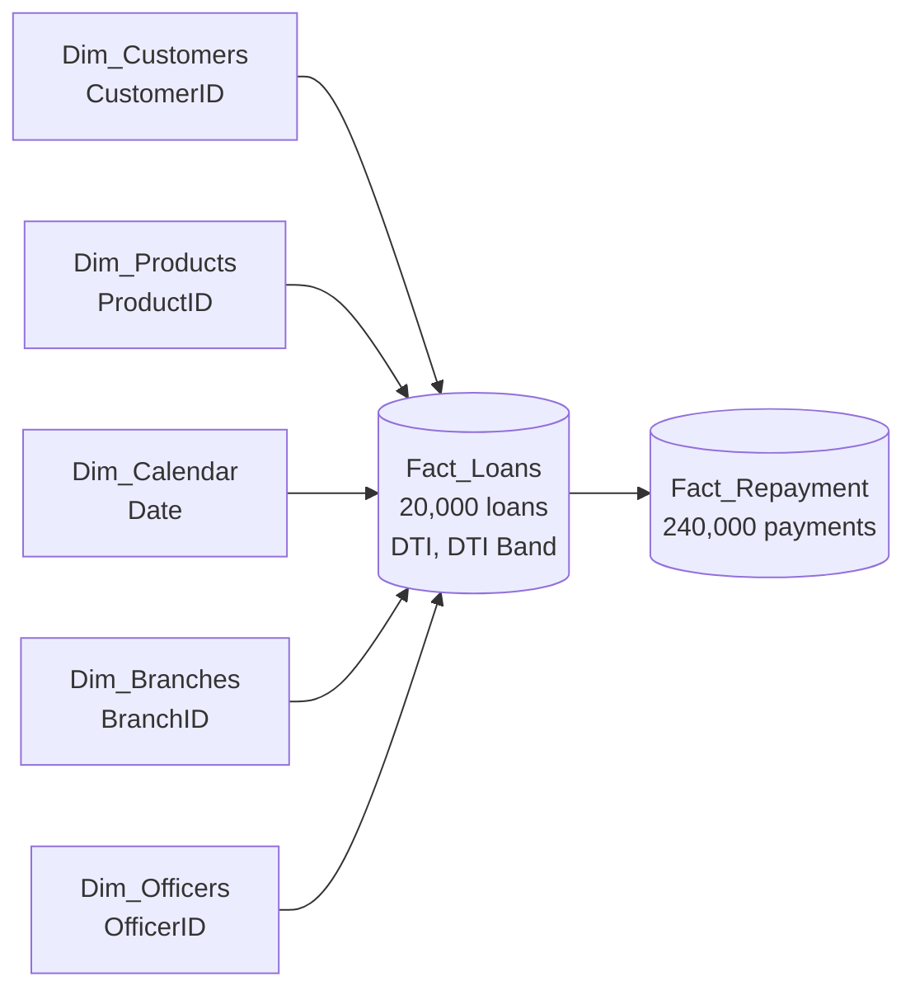

# Cleaning and Transformation Steps

**Project:** Operation Threshold: Debt-Burden Risk & First-Payment Default Diagnostic<br>
**Tools:** Excel Power Query (cleaning and transformation), Power Pivot (data model)

I turned **20,100 raw loan records** and **240,000 repayment records** into a clean star schema: two fact tables and five dimension tables, ready to answer the Risk Committee's question: **does debt burden predict default?**

That answer depends on one number per loan, the **Debt-to-Income (DTI) ratio**. So every cleaning decision below was made with one test in mind: *will this step make each loan's DTI more trustworthy?*

---

## Contents

1. [Starting point](#starting-point)
2. [Assumptions](#assumptions)
3. [Fact_Loans](#fact_loans)
4. [Fact_Repayment](#fact_repayment)
5. [Dimension tables](#dimension-tables)
6. [Final model](#final-model)

---

## Starting point

| File | Rows | Issues found |
| --- | --- | --- |
| `Loans_raw.csv` | 20,100 | Duplicate loans, inconsistent text casing, 3% missing income, amounts stored as text, three date formats, no installment column |
| `Repayments_raw.csv` | 240,000 | Inconsistent payment status casing, 8,526 blank payment amounts |
| `Products_ref.csv` | 4 | Headers not promoted, no ID column |
| `Branches_ref.csv` | 10 | One messy branch name |
| `Officers_ref.csv` | 40 | One officer name in all caps |
| `Dim_Calendar.csv` | 1,461 | Clean |

## Assumptions

- **Fixed monthly repayment.** Each customer pays the same amount every month. I verified this before relying on it: for all 20,000 loans, `ScheduledAmount` is identical across every payment month.
- **Customer identity.** The source has no customer ID, so a customer is identified by **CustomerName + Age + Gender**.
- **A blank payment on a missed month means nothing was paid.** Every blank `AmountPaid` sits on a row marked *Missed*.

> **One pattern for every text fix.** Wherever a text column was messy, I applied the same steps in the same order: **Capitalize Each Word → Trim → Clean** (where hidden characters were possible). One pattern everywhere keeps the queries predictable and easy to audit.

---

## Fact_Loans

This table needed the most work, because both inputs to the DTI ratio (income and installment) either lived here or had to be brought here.

### Step 1: Remove duplicate loans

| | |
| --- | --- |
| **Found** | 20,100 rows but only 20,000 unique `LoanID`s. The extra 100 rows were exact copies. |
| **Why it matters** | A duplicated loan is counted twice in total loans, total value and default rate. |
| **Action** | Selected `LoanID` → Remove Duplicates. |
| **Result** | 20,000 rows, one per loan. |

| Before | After |
| --- | --- |
|  |  |

### Step 2: Standardise the text columns

**Found:** the same value written in different ways. `Region` had 30 spellings of 10 cities (Liverpool, liverpool, LIVERPOOL). `EmploymentSector` had 12 spellings of 4 sectors. `Gender` used single letters.

**Why it matters:** Power Query and PivotTables treat "Salaried" and "SALARIED" as two groups. The income fix in Step 3 groups by sector, so this column had to be clean first.

| Column | Transformation | Result |
| --- | --- | --- |
| `CustomerName` | Trim → Capitalize Each Word | Consistent name format |
| `Gender` | Replace `M` → `Male`, `F` → `Female` | Readable labels on visuals |
| `Region` | Capitalize Each Word → Trim | 30 variants → 10 regions |
| `EmploymentSector` | Capitalize Each Word → Trim → Clean | 12 variants → 4 sectors |

| Before | After |
| --- | --- |
|  |  |

### Step 3: Fill the missing monthly income

**Found:** 600 of 20,000 loans (**3%**) had no `MonthlyIncome`, spread across all four sectors.

**Why it matters:** DTI divides by income. A blank income means a blank DTI, so those loans would silently drop out of the band analysis.

**Why not delete them?** Removing 3% of loans would also remove their repayment history and could bias the default rate.

**Why the median, and why by sector?** Income is skewed, so a few high earners pull the average up; the median is more representative. Income also differs by sector, so one overall figure would overstate a gig worker's income and understate a salaried worker's.

| Employment sector | Median monthly income (£) | Loans filled |
| --- | --- | --- |
| Salaried | 2,317.50 | 222 |
| Self-Employed | 2,179.50 | 136 |
| Public Sector | 2,003.00 | 146 |
| Gig/Freelance | 1,522.00 | 96 |

**Action:**

1. Duplicated the loans query and named it `MonthlyIncome`.
2. Kept only `EmploymentSector` and `MonthlyIncome`.
3. Grouped by `EmploymentSector` with the **median** of `MonthlyIncome`.
4. Merged the grouped table back into the loans data on `EmploymentSector`.
5. Expanded only the median income column.
6. Added a conditional column, `MonthlyIncome2`: if `MonthlyIncome` is null, return the sector median; otherwise keep the original value.
7. Removed the old column and renamed `MonthlyIncome2` to `MonthlyIncome`.

```m
if [MonthlyIncome] = null then [Median Salary] else [MonthlyIncome]
```

**Result:** 0 missing incomes, and the 19,400 real incomes are untouched.

| Before | After |
| --- | --- |
|  |  |

### Step 4: Convert LoanAmount from text to number

| | |
| --- | --- |
| **Found** | 1,600 amounts stored as text, such as `£10,900`. |
| **Why it matters** | Text cannot be summed, so total portfolio value would be wrong. |
| **Action** | Replaced `£` with nothing → replaced `,` with nothing → changed type to Decimal Number. |
| **Result** | A fully numeric `LoanAmount` column. |

| Before | After |
| --- | --- |
|  |  |

### Step 5: Fix the three date formats in DisbursedDate

**Found:** one column, three formats.

| Format | Example | Rows |
| --- | --- | --- |
| `yyyy-MM-dd` | 2023-12-26 | 7,943 |
| `d/M/yyyy` | 30/10/2024 | 7,927 |
| Long text | 12 January 2024 | 4,130 |

**Why it matters:** a plain type change guesses the format and can swap day and month (is 03/04 the 3rd of April or the 4th of March?). Dates also connect the loans to the calendar table.

**Action:** instead of letting Excel guess, I added a custom column that reads each format explicitly, then replaced the original column and set the type to Date.

```m
if Text.Contains([DisbursedDate], "/") then Date.FromText([DisbursedDate], [Format="d/M/yyyy"])
else if Text.Contains([DisbursedDate], "-") then Date.FromText([DisbursedDate], [Format="yyyy-MM-dd"])
else Date.FromText([DisbursedDate], [Culture="en-GB"])
```

**Result:** all 20,000 dates parsed, from 10 Jan 2023 to 30 Dec 2024.

| Before | After |
| --- | --- |
|  |  |

### Step 6: Bring in the monthly installment

**Found:** the loans file has no installment column. It lives in the repayments file as `ScheduledAmount`, repeated for every month of every loan.

**Why it matters:** the installment is the top half of the DTI ratio.

**Action:** because the repayment is fixed every month, any single month gives the installment. I used the first:

1. Created a helper query, `LoanInstallments`, referencing the cleaned repayments table.
2. Filtered `PaymentMonth = 1`, which leaves exactly one row per loan.
3. Kept only `LoanID` and `ScheduledAmount`.
4. Merged it into Fact_Loans on `LoanID` and renamed the column `MonthlyInstallment`.

**Result:** every one of the 20,000 loans has an installment.

| Before | After |
| --- | --- |
|  |  |

### Step 7: Replace customer details with a CustomerID

**Action:** once `Dim_Customers` was built ([see below](#dim_customers)), I merged it into Fact_Loans on `CustomerName`, `Age` and `Gender`, kept only `CustomerID`, and removed the customer columns (`CustomerName`, `Age`, `Gender`, `Region`, `EmploymentSector`).

**Why:** customer details describe the customer, not the loan. Moving them out keeps the fact table lean and the model a true star schema. `MonthlyIncome` stays in the fact table because it is captured per loan and feeds DTI.

| Before | After |
| --- | --- |
|  |  |

### Step 8: Calculate the Debt-to-Income ratio

Added a custom column, `DTI` (Decimal Number):

```m
[MonthlyInstallment] / [MonthlyIncome]
```

**Result:** the median loan takes **19.6%** of the customer's monthly income. The highest takes **2.38 times** their income.

| Before | After |
| --- | --- |
|  |  |

### Step 9: Group DTI into risk bands

**Why:** a ratio such as 0.3412 is hard to discuss in a committee meeting. Bands turn it into a category the Risk Committee can compare default rates across.

**Action:** added a conditional column, `DTI Band`:

| DTI ratio | Band | Loans | Share |
| --- | --- | --- | --- |
| Less than 0.20 | Low | 10,272 | 51.4% |
| 0.20 to under 0.35 | Moderate | 5,685 | 28.4% |
| 0.35 to under 0.50 | High | 3,112 | 15.6% |
| 0.50 and above | Severe | 931 | 4.7% |

**Result:** about one loan in five (4,043) takes 35% or more of the customer's monthly income. These are the loans the analysis tests for higher default.

| Before | After |
| --- | --- |
|  |  |

---

## Fact_Repayment

12 monthly payments for each of the 20,000 loans. Two fixes, and both matter for the first-payment default question.

### Step 1: Standardise PaymentStatus

| | |
| --- | --- |
| **Found** | 3 statuses written 9 ways: On-Time / on-time / ON-TIME, Late / late / LATE, Missed / missed / MISSED. |
| **Why it matters** | Missed payments feed both the default rate and the first-payment default check. Counting "missed" and "MISSED" separately understates them. |
| **Action** | Capitalize Each Word → Trim. |
| **Result** | 3 statuses: On-Time (205,254), Late (17,694), Missed (17,052). |

| Before | After |
| --- | --- |
|  |  |

### Step 2: Fill blank AmountPaid on missed payments

**Found:** 8,526 rows had no `AmountPaid`. Every one was a *Missed* payment.

**Why it matters:** a blank is ignored by SUM and AVERAGE, so the average amount paid would look healthier than it is. For a missed payment, the true amount paid is zero.

**Action:** added a custom column and replaced the original:

```m
if [PaymentStatus] = "Missed" and [AmountPaid] = null then 0 else [AmountPaid]
```

I checked the status as well as the blank on purpose. A blank on an On-Time or Late row would mean something different, and it should not be quietly set to zero.

**Result:** 0 blanks in `AmountPaid`.

| Before | After |
| --- | --- |
|  |  |

---

## Dimension tables

The dimensions describe the *who, what, where and when* of each loan. Most reference files were nearly clean, so the work here was about structure: giving every table a key the fact table can point to.

### Dim_Customers

**Goal:** pull customer details out of the loans table into their own table, so each customer is stored once.

1. Duplicated the cleaned loans query.
2. Kept only the customer columns: `CustomerName`, `Age`, `Gender`, `Region`, `EmploymentSector`, `MonthlyIncome`.
3. Treated **CustomerName + Age + Gender** as a composite key (the source has no customer ID).
4. Removed duplicates on that composite key.
5. Added an index column starting at 1 and named it `CustomerID` (primary key).
6. Merged `CustomerID` back into Fact_Loans on the same three columns ([Fact_Loans Step 7](#step-7-replace-customer-details-with-a-customerid)).

**Result:** 18,916 unique customers from 20,000 loans; 1,043 customers hold more than one loan.

| Before | After |
| --- | --- |
|  |  |

### Dim_Products

1. Promoted the first row to headers.
2. Checked the columns: all clean.
3. Added an index column, `ProductID`, as a surrogate primary key.
4. Merged Dim_Products into Fact_Loans on `ProductType`, so the fact table keeps only `ProductID`.

**Why a surrogate key:** a short number is a lighter, safer join key than a text label, and the relationship survives if a product is ever renamed.

**Result:** 4 products: Personal, SME, Auto, Mortgage.

| Before | After |
| --- | --- |
|  |  |

### Dim_Branches

| | |
| --- | --- |
| **Found** | `" manchester branch"`: a leading space and lower case. |
| **Action** | Promoted headers → Capitalize Each Word → Trim on `BranchName`. |
| **Result** | 10 consistent branch names. |

| Before | After |
| --- | --- |
|  |  |

### Dim_Officers

| | |
| --- | --- |
| **Found** | `"FATIMA SHEIKH"` in all caps. |
| **Action** | Capitalize Each Word → Trim on `OfficerName`. |
| **Result** | 40 officer names in one format. |

| Before | After |
| --- | --- |
|  |  |

### Dim_Calendar

Already clean: 1,461 days from 1 Jan 2023 to 31 Dec 2026, no blanks, no duplicate dates, covering every disbursement date. I only set the data types so it can join to `DisbursedDate`.


---

## Final model

Six raw files became seven clean tables, each joined by a single key. Two helper queries (`MonthlyIncome` and `LoanInstallments`) exist only to feed Fact_Loans.

| Table | Rows before → after | What changed |
| --- | --- | --- |
| Fact_Loans | 20,100 → 20,000 | 100 duplicates removed, 600 incomes filled, 1,600 amounts converted, 3 date formats unified, installment, DTI and DTI Band added |
| Fact_Repayment | 240,000 → 240,000 | 9 status spellings → 3, 8,526 blank payments set to 0 |
| Dim_Customers | new → 18,916 | Built from the loans data, CustomerID added |
| Dim_Products | 4 → 4 | Headers promoted, ProductID added |
| Dim_Branches | 10 → 10 | 1 branch name fixed |
| Dim_Officers | 40 → 40 | 1 officer name fixed |
| Dim_Calendar | 1,461 → 1,461 | Data types set |




Every dimension filters Fact_Loans through one key, so a slicer on branch, officer, product or month flows straight through to the DTI and default figures.
